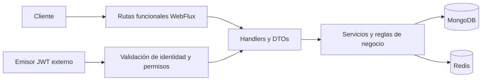

# Eats Hub · Backend Java reactivo

API de catálogo de restaurantes, preparación de disponibilidad y gestión de reservas.
Proyecto de aprendizaje de **Luis Brenis**, iniciado a partir de un curso y ampliado
para practicar diseño de APIs, seguridad, persistencia y evolución de contratos.
Se presenta su estado actual de desarrollo; no se declara listo para producción.

## Problema y solución

Un restaurante necesita organizar mesas, combinaciones, turnos y zona horaria antes
de aceptar reservas. Eats Hub separa esa preparación de la gestión de reservas e
incorpora controles de permisos, concurrencia y reintentos para evolucionar desde
el contrato antiguo hacia un modelo de reservas v2.

## Funcionalidades y estado

| Área | Implementación | Validación y límites |
|---|---|---|
| Catálogo | Listado y filtros por nombre, cocina, precio y ciudad; caché Redis | Recorrido básico documentado; sin nueva ejecución para esta entrega |
| Mesas | Alta, consulta y actualización con permisos, ETag e idempotencia | SPEC-001 cerrada y aprobada por el responsable |
| Combinaciones | Capacidad derivada y protección de cambios incompatibles | SPEC-002 cerrada y aprobada por el responsable |
| Turnos y zona horaria | Horarios y cambios conservando historia | SPEC-003 cerrada y aprobada por el responsable |
| Reservas v2 | Código de confirmación, consulta, modificación y cancelación; coordinación transaccional y recibos | SPEC-004–008 en desarrollo; gate apagado por defecto |
| Puente del legado | Preparación de JAR, verificación y consumidores de corte/reversión | Candidato real preparado; último ensayo fallido antes de Docker. Sin Review real ni aprobación de SPEC-005 |

Los resultados históricos corresponden a versiones concretas y no acreditan los
cambios locales posteriores. Véase [estado y validación](docs/estado-portafolio.md).

## Tecnologías

- Java 21, Spring Boot **4.0.1**, Spring WebFlux y Project Reactor (`Mono` / `Flux`).
- MongoDB reactivo, transacciones sobre replica set y caché con Redis reactivo.
- Spring Security OAuth2 Resource Server y JWT; Keycloak para identidad local.
- Gradle Wrapper **9.2.1**, JUnit, Reactor Test, Spring Security Test y Testcontainers.
- MapStruct **1.6.3**, Lombok y scripts PowerShell, JavaScript y Python.

El build también incluye R2DBC/PostgreSQL. `customer-manager` es un servicio separado
en desarrollo; no se presenta una arquitectura completa de microservicios ni se
necesita ese servicio para la demo básica del catálogo.

## Arquitectura

Rutas y handlers adaptan HTTP; los servicios coordinan reglas y persistencia.
El catálogo utiliza caché. Disponibilidad y reservas incorporan coordinación de
cambios, revisiones y recibos persistidos.

## Decisiones técnicas

- **Composición reactiva:** flujos Reactor dentro de WebFlux. No se atribuyen
  mejoras de rendimiento sin mediciones.
- **Concurrencia:** ETag/If-Match y coordinación transaccional para evitar cambios
  sobre revisiones obsoletas.
- **Reintentos:** idempotencia y recibos para distinguir una repetición de una
  operación nueva.
- **Identidad externa:** validación de JWT y permisos por restaurante, sin base
  propia de contraseñas de usuarios en el servicio.
- **Evolución gradual:** gates y barrera del legado; el corte de reservas v2 sigue
  pendiente de evidencia y aprobación.

## Ejecutar y demostrar

1. [Configuración local reproducible](docs/ejecucion-local-portafolio.md).
2. [Ejemplos de API y guion de demostración](docs/demo-portafolio.md).
3. [Resultados, pendientes y publicación](docs/estado-portafolio.md).

La demo básica requiere MongoDB y Redis. El flujo protegido de disponibilidad
necesita además replica set e identidad: [guía existente](docs/identidad-local.md).
No hace falta activar reservas v2 ni ejecutar un corte para presentar el catálogo.

## Mi contribución

Partiendo de la base del curso, trabajé en la evolución de mesas, combinaciones,
turnos, identidad y reservas, sus contratos, pruebas y procedimientos de validación.
Utilizo especificaciones y asistencia de IA; las ejecuciones locales y aprobaciones
se registran por separado del código preparado. Este proyecto representa aprendizaje
y trabajo personal, no experiencia laboral ni resultados de clientes.

## Límites actuales

El cliente del planificador del contrato antiguo simula disponibilidad. La gestión
de reservas sigue en desarrollo. No hay despliegue público, métricas de rendimiento
ni capturas de una demo verificadas para esta entrega. Las guías operativas anteriores
conservan notas históricas; el estado vigente de presentación está enlazado arriba.
